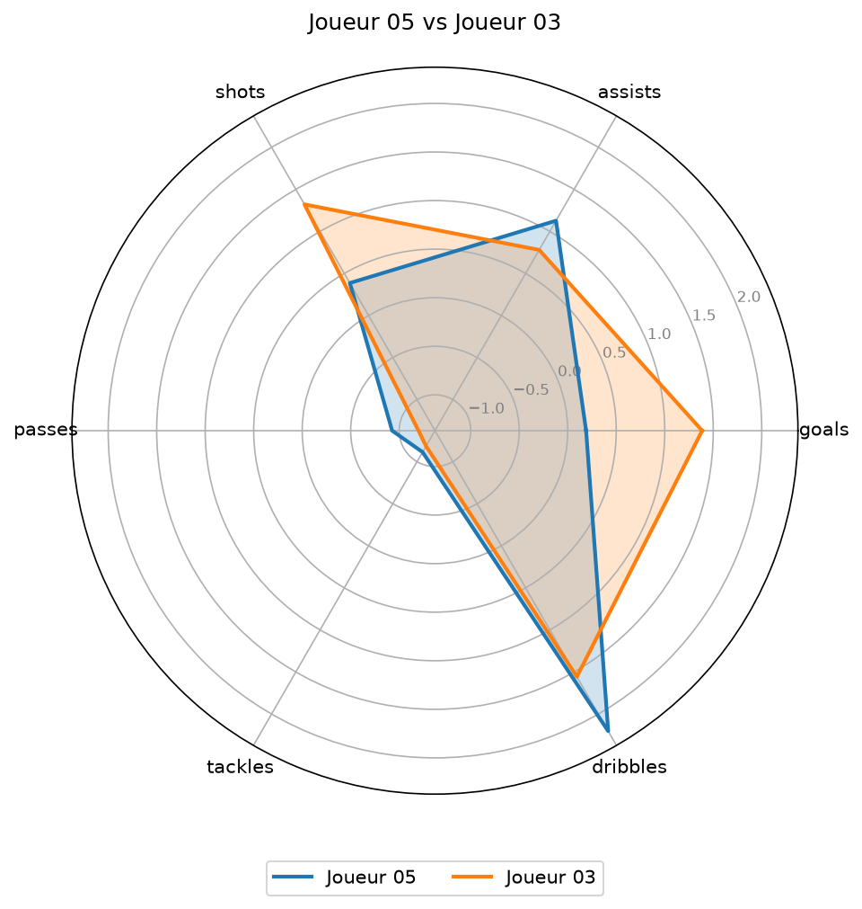

# Football Player Similarity

Outil Python qui trouve les joueurs de football au profil statistique le plus proche d'un joueur donné, et visualise la comparaison sous forme de radar chart.

## Principe

1. Les statistiques "par 90 minutes" (buts, passes décisives, tirs, passes, tacles, dribbles) sont standardisées en **z-scores**, pour que chaque stat pèse autant, quelle que soit son échelle.
2. La similarité entre deux joueurs est mesurée par la **distance euclidienne** entre leurs vecteurs de z-scores : plus la distance est faible, plus les profils sont proches.
3. Un **radar chart** permet de vérifier visuellement la ressemblance.

## Exemple

Joueurs les plus proches de `Joueur 05` :

| Joueur    | Club   | Poste | Distance |
|-----------|--------|-------|----------|
| Joueur 03 | Club B | FW    | 1.71     |
| Joueur 19 | Club D | MF    | 1.98     |
| Joueur 06 | Club C | MF    | 2.27     |
| Joueur 11 | Club F | MF    | 2.30     |
| Joueur 18 | Club B | FW    | 2.75     |



## Installation

```bash
python -m venv venv
venv\Scripts\activate        # Windows
pip install -r requirements.txt
```

## Utilisation

Modifier `NOM_JOUEUR` dans `main.py`, puis :

```bash
python main.py
```

## Structure du projet

```
├── data/players.csv     # données (fictives)
├── similarity.py        # chargement, standardisation, calcul de similarité
├── visualisation.py     # radar chart
├── main.py              # point d'entrée
└── requirements.txt
```

## Limites

- Les données sont fictives : le projet démontre la méthode, pas des conclusions réelles.
- La distance euclidienne traite toutes les stats avec le même poids.
- Pas de distinction entre postes dans la comparaison.

## Pistes d'amélioration

- Utiliser de vraies données (FBref, Understat).
- Pondérer les stats selon le poste.
- Comparer avec la similarité cosinus.